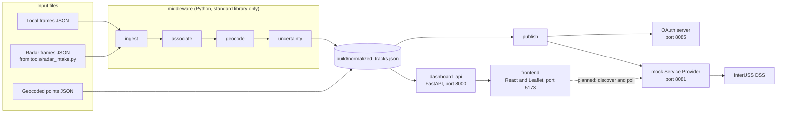
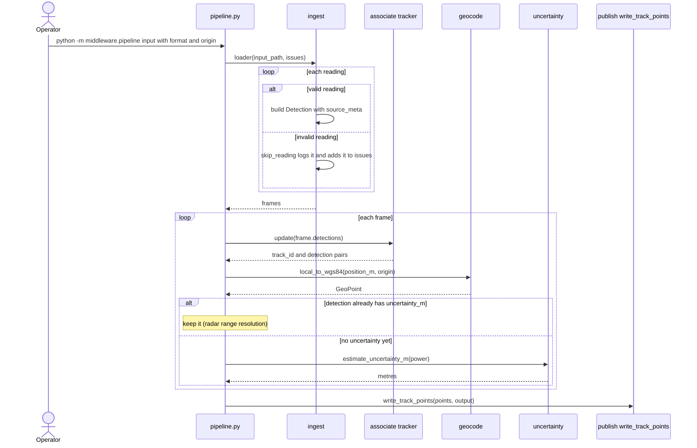
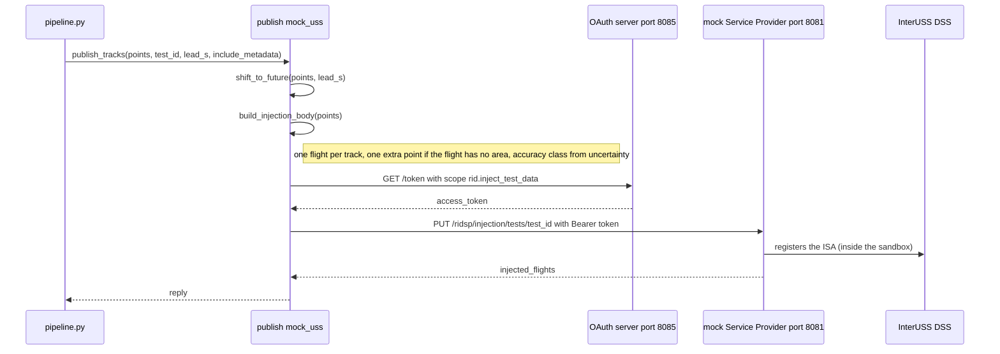
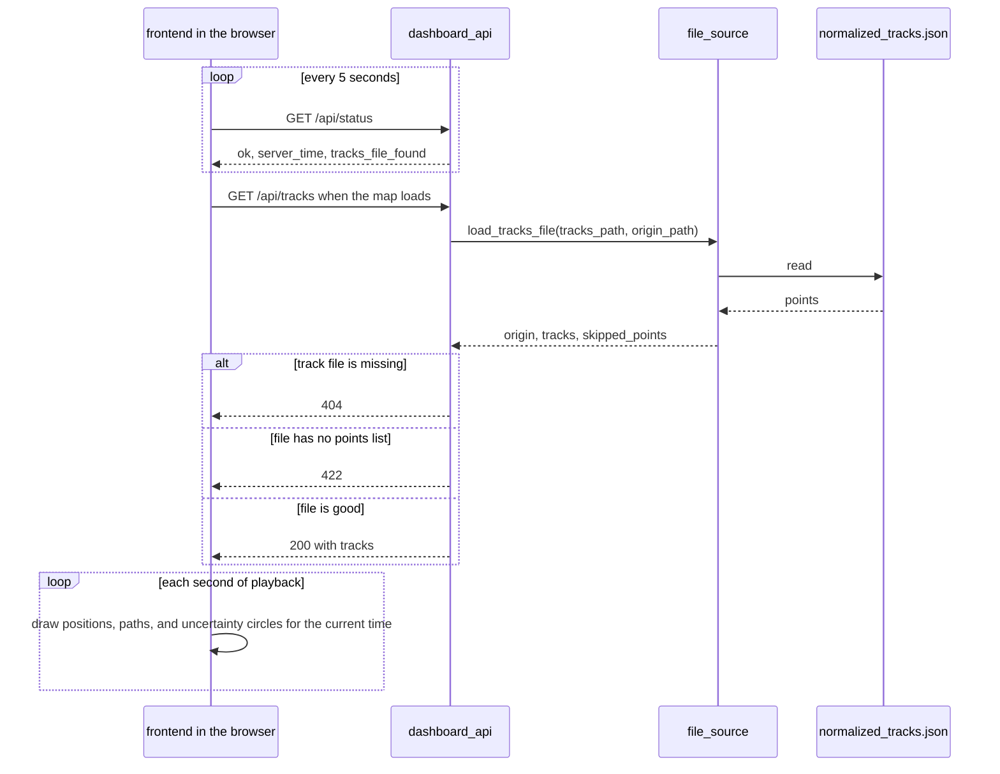
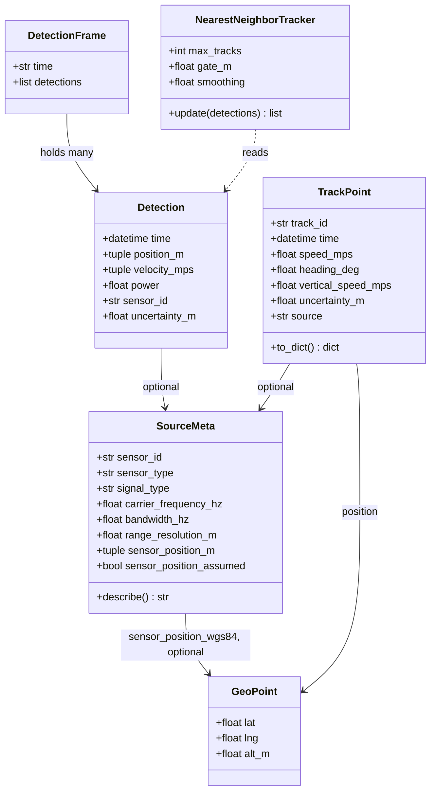

# Architecture

This file shows how the pieces of the repo connect: who calls whom, and what passes between them. The exact fields of every file and message are in [INTERFACES.md](INTERFACES.md). Setup and run steps are in the [README](../README.md) and [SETUP.md](../SETUP.md).

**Keep this file current.** Update it in the same pull request as any change that adds, removes, or renames a module, changes who calls whom, or changes a file or message. The table at the bottom says which part to update. The diagrams are text (Mermaid). GitHub draws them, and a change to a diagram shows up in the pull request like any other change. To preview one while editing, paste it into <https://mermaid.live>.

## 1. The system

Geocoded input is already latitude and longitude, so it skips `associate`, `geocode`, and `uncertainty` and goes straight to the track file. The dotted line is designed but not built: today the frontend reads the track file through the dashboard API, not InterUSS.

## 2. Design names and code

The design documents and slides use the names in the left column.

| Design name | Code | Folder or file |
|---|---|---|
| Sensing intake | Readers for each input shape and the source metadata reader | `middleware/ingest/` (`synthetic.py` for local and geocoded files, `sionna.py` for radar) |
| Track builder | Tracker, coordinate conversion, uncertainty, run in order by the pipeline | `middleware/associate/tracker.py`, `middleware/geocode/wgs84.py`, `middleware/uncertainty/estimate.py`, `middleware/pipeline.py` |
| USS publisher | Track file writer and the InterUSS injection | `middleware/publish/mock_uss.py` |
| Dashboard API | Serves the track file to the map | `dashboard_api/` |
| Frontend | The map | `frontend/` |
| Radar input tool | Runs HermesPy and writes a radar input file | `tools/radar_intake.py` |

`middleware/publish/interuss_adapter.py` and `interuss_demo.py` are an earlier prototype payload. `--publish` does not use them.

## 3. What each module does

Each has one job.

| Module | Job | Reads | Gives back |
|---|---|---|---|
| `ingest/synthetic.py` | Read local or geocoded files, build `SourceMeta`, skip invalid readings | Input file | `DetectionFrame` list or `TrackPoint` list |
| `ingest/sionna.py` | Read radar range and power, place each reading on the map | Radar file | `DetectionFrame` list |
| `associate/tracker.py` | Give detections track ids, estimate speed | Detections of one frame | `(track_id, Detection)` pairs |
| `geocode/wgs84.py` | East, north, up metres to latitude, longitude, altitude | Position and scene origin | `GeoPoint` |
| `uncertainty/estimate.py` | Estimate uncertainty from power, compute range resolution from bandwidth | Power or bandwidth | Metres |
| `pipeline.py` | Run the steps in order, build `TrackPoint`s, write the file, optionally publish | Command line arguments | Track file |
| `publish/mock_uss.py` | Write the track file, build and send the injection | `TrackPoint` list | Track file, sandbox reply |
| `dashboard_api/` | Group the track file by track and serve it | Track file, scene origin | JSON for the frontend |
| `frontend/` | Draw positions, paths, and uncertainty, play back by time | Dashboard API | The map |

## 4. A pipeline run

## 5. Publishing to InterUSS

## 6. Showing tracks on the map

The Vite dev server forwards requests that start with `/api` to port 8000.

## 7. Data types

## 8. Not built yet

- Reading Sionna output. Today the input is a HermesPy radar file, a local frames file, or a geocoded file.
- The frontend finding the Service Provider through the DSS and polling it. Today it reads the track file.
- A real DSS client. The sandbox injection route is the publish path.
- Direction from a single radar. Each range is placed straight north.
- Using Doppler speed in the tracker. Speed comes from position changes.

## 9. Which file to update

| You changed | Update |
|---|---|
| A field in an input file or the track file | `INTERFACES.md` (the section for that file), and the data types diagram above |
| An HTTP call or the API response | `INTERFACES.md` (sections 4 and 5), and the matching sequence diagram |
| Who calls whom, or the order of steps | The matching sequence diagram, and the table in section 3 |
| A new module, folder, or top-level file | The table in section 3, the system diagram, and the README layout |
| A feature that is now built | Remove it from section 8, and draw its line solid in section 1 |
